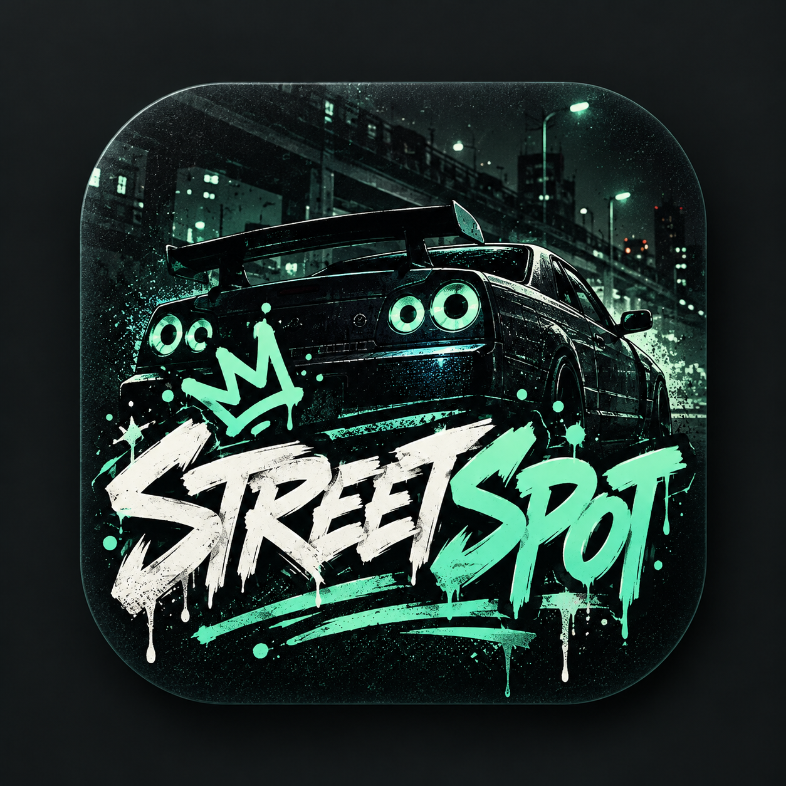

# STREETSPOT



**Локальный автомобильный дневник для Android.** Замечайте автомобили, сохраняйте фотографии и собирайте коллекцию моделей с XP и достижениями.

Интерфейс приложения сейчас на русском языке. Базовый дневник работает без аккаунта и сети. Firebase используется только для необязательного социального слоя.

## Возможности

- Добавление автомобильных находок с фотографией через CameraX или Android Photo Picker.
- Поиск марки и модели в офлайн-каталоге, создание собственных марок и моделей.
- Коллекция моделей, история находок, уровни, XP и достижения.
- Статистика и два виджета главного экрана.
- Локальные настройки темы и ручной экспорт/восстановление ZIP-резервной копии.
- Необязательные аккаунты, профили и список друзей через Firebase; публикация сведений и фотографий управляется отдельно.

## Приватность

- Spot-записи, фотографии, заметки, XP и достижения хранятся локально в Room. Полный журнал не синхронизируется с Firebase.
- Для базовых функций не нужен аккаунт или интернет.
- Профиль и фотографии не публикуются без отдельного согласия. Координаты GPS и номера автомобилей приложение не собирает.
- Удаление аккаунта Firebase не удаляет локальный дневник.

## Технологии

Kotlin, Jetpack Compose, Material 3, Navigation Compose, Room, DataStore, Coroutines/Flow, CameraX, Android Photo Picker и Jetpack Glance. Необязательный социальный слой использует Firebase Authentication и Cloud Firestore; выбранные фото хранятся в private Supabase Storage через Edge Function.

Проект состоит из одного Android-модуля `app`.

## Сборка

Требуются Android Studio, Android SDK Platform 37 и JDK 25 для Gradle daemon. Приложение поддерживает Android 8.0 (API 26) и новее; bytecode собирается для JVM 17.

Из корня проекта:

```powershell
# Windows
.\gradlew.bat :app:assembleDebug

# macOS / Linux
./gradlew :app:assembleDebug
```

Debug APK появится в `app/build/outputs/apk/debug/app-debug.apk`. Для установки на подключённое устройство с включённой USB-отладкой:

```shell
adb install -r app/build/outputs/apk/debug/app-debug.apk
```

Production-подпись для release-сборки в проекте не настроена.

## Firebase, Supabase и локальные проверки

Production Firebase и Supabase проекты в репозитории не настроены. В debug-варианте без `app/google-services.json` приложение использует demo Firebase project `demo-streetspot` и локальные эмуляторы Auth и Firestore. Фото в этом режиме не работают: Firebase Emulator tokens нельзя отправлять удалённой Supabase Edge Function.

Для тестов правил нужны Node.js 24+, Firebase CLI 15.34.1+ и Java 21+:

```shell
cd tools/firebase-rules-tests
npm ci
npm test
```

Локальные тесты Firebase покрывают Auth и Firestore Security Rules. Для USB-устройства запустите эмуляторы из корня проекта:

```shell
firebase emulators:start --project demo-streetspot --only auth,firestore
```

В другом терминале выполните:

```shell
adb reverse tcp:9099 tcp:9099
adb reverse tcp:8080 tcp:8080
```

### Подключение бесплатных проектов

1. Создайте Firebase-проект на Spark, включите Email/Password Authentication и Firestore. Добавьте `app/google-services.json` в `app/` и разверните проверенные правила:

   ```shell
   firebase deploy --only firestore --project <firebase-project-id>
   ```

2. Создайте Supabase Free project. В Supabase CLI войдите и привяжите локальную папку к проекту:

   ```shell
   supabase login
   supabase link --project-ref <supabase-project-ref>
   supabase db push
   supabase secrets set FIREBASE_PROJECT_ID=<firebase-project-id>
   supabase functions deploy shared-photos
   ```

   Миграция создаёт private bucket `shared-spot-photos` с лимитом 5 МБ и MIME `image/jpeg`. Edge Function использует серверный service key из окружения Supabase; не копируйте его в Android или Git.

3. Возьмите project URL и publishable key из Supabase Dashboard → API Settings и добавьте строки в уже существующий игнорируемый `local.properties` в корне проекта:

   ```properties
   streetspot.supabase.url=https://<supabase-project-ref>.supabase.co
   streetspot.supabase.publishableKey=<publishable-key>
   ```

   Publishable key в Android допустим; service/secret key — нет. Firebase project ID в `app/google-services.json` должен совпадать со значением `FIREBASE_PROJECT_ID` в Edge Function.

Социальные аккаунты и Firestore остаются на бесплатном Firebase Spark; Firebase Cloud Storage не используется, поскольку он требует Blaze. Бесплатные лимиты Supabase сейчас включают 1 ГБ Storage и 10 ГБ egress за месяц; неактивные проекты могут приостанавливаться после недели низкой активности. Проверяйте [актуальные тарифы Supabase](https://supabase.com/pricing) перед публикацией. Подробное описание приватности, ограничения и настройка тестовых проектов приведены в [`docs/social-and-firebase.md`](docs/social-and-firebase.md).

## Каталог автомобилей и атрибуция

В приложение встроен офлайн-каталог VehiclesDB v2026.10.4. Данные каталога имеют лицензию CC BY 4.0 и требуют атрибуции; первичные источники данных могут иметь отдельные условия. Сохраняйте файлы лицензии и атрибуции при распространении. Подробности: [`docs/vehicle-catalog.md`](docs/vehicle-catalog.md) и `app/src/main/assets/vehiclesdb/ATTRIBUTION.md`.

Лицензия на исходный код STREETSPOT пока не добавлена. Лицензия каталога VehiclesDB не задаёт лицензию кода приложения; перед публикацией репозитория выберите и добавьте отдельный корневой `LICENSE`.

## Документация

- [Спецификация](docs/specification.md)
- [Архитектура](docs/architecture.md)
- [План разработки](docs/development-plan.md)
- [Дизайн-система](docs/design-system.md)
- [Правила XP и достижений](docs/xp-and-achievements.md)
- [Социальный слой и Firebase](docs/social-and-firebase.md)
- [Каталог и источники данных](docs/vehicle-catalog.md)

Перед релизом нужно отдельно проверить миграцию Room 2→3 и восстановление резервных архивов версий 1–3; текущее состояние проекта отражено в [`docs/continue-here.md`](docs/continue-here.md).
